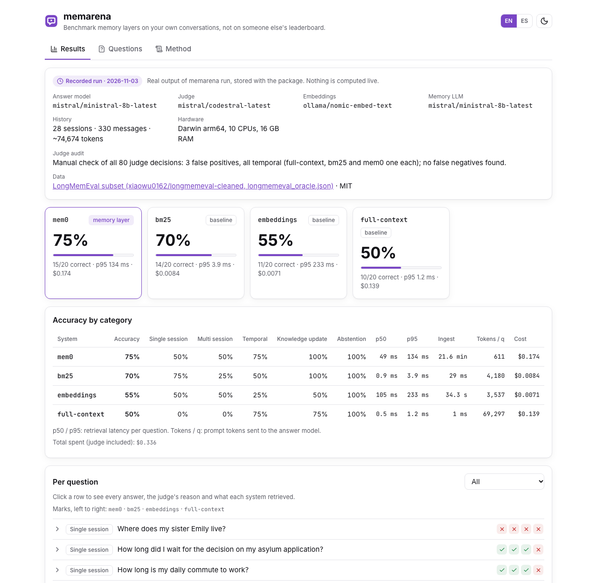
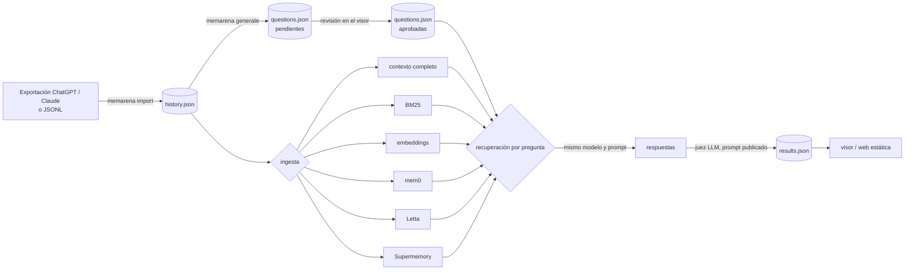

<p align="center">
  
</p>

<p align="center">
  <a href="https://github.com/diegoperezg7/memarena/actions/workflows/ci.yml"></a>
  <a href="LICENSE"></a>
  <a href="https://github.com/diegoperezg7/memarena/releases"></a>
  <a href="https://github.com/diegoperezg7/memarena/stargazers"></a>
</p>

<p align="center"><b>Compara capas de memoria con tus propias conversaciones, no con el ranking de otro.</b></p>

<p align="center"><a href="README.md">English</a> · Español · <a href="https://diegoperezg7.github.io/memarena/">Visor de ejemplo</a></p>

memarena convierte tu exportación de ChatGPT o Claude en un test de memoria: escribe preguntas con su
respuesta correcta a partir de tu propio historial (las revisas tú), mete el historial en cada capa de memoria,
hace cada pregunta y puntúa las respuestas con un juez LLM cuyo prompt está publicado. Cada ejecución incluye
siempre lo que una capa de memoria tiene que superar: **pegar el historial entero** y **una recuperación simple**
(BM25 y embeddings).



## Por qué

Los arneses públicos de memoria los publica cada uno un fabricante de memoria y giran en torno a datasets fijos:
[supermemoryai/memorybench](https://github.com/supermemoryai/memorybench) (334 estrellas, Supermemory),
[vectorize-io/agent-memory-benchmark](https://github.com/vectorize-io/agent-memory-benchmark) (163, Vectorize) y
[mem0ai/memory-benchmarks](https://github.com/mem0ai/memory-benchmarks) (134, Mem0) (estrellas a 3 nov 2026).

Las cifras de los fabricantes no cuadran entre sí. El paper de Mem0 da, en LoCoMo, un 26 % de mejora relativa en
LLM-as-a-Judge frente a la memoria de OpenAI, y un 91 % menos de latencia p95 y más de un 90 % menos de tokens
que el contexto completo ([arXiv 2504.19413](https://arxiv.org/abs/2504.19413)). Letta publicó después un 74,0 %
en LoCoMo con GPT-4o mini para un agente con sistema de ficheros, frente al 68,5 % que Mem0 publicó para sí mismo,
y añadió «Mem0 did not respond to requests for clarification»
([blog de Letta, 12 ago 2025](https://www.letta.com/blog/benchmarking-ai-agent-memory)). Zep da un 94,8 % en DMR
frente al 93,4 % de MemGPT y hasta un 18,5 % más de acierto en LongMemEval
([arXiv 2501.13956](https://arxiv.org/abs/2501.13956)).

Tenga razón quien la tenga en LoCoMo, nada de eso dice cómo funciona una capa de memoria con **tus**
conversaciones, con **tu** modelo, frente a la opción barata de pegarlo todo. memarena es neutral, trabaja sobre
tus exportaciones y pone siempre contexto completo, BM25 y embeddings en la misma tabla.

## Inicio rápido

Demo grabada, sin claves, sin Docker y sin llamadas a modelos (menos de 2 minutos en una máquina limpia con `uv`):

```bash
uvx memarena demo
```

o desde un clon:

```bash
git clone https://github.com/diegoperezg7/memarena && cd memarena && uv run memarena demo
```


Imprime la tabla de abajo y abre el visor en http://127.0.0.1:8765, que sigue en marcha hasta que pulses Ctrl+C (`--no-view` para solo imprimir).

## Ejemplo de salida

Es una **ejecución real grabada** (`memarena run`, 3 nov 2026) que va dentro del paquete y que muestra
`memarena demo`: 20 preguntas (4 por categoría) de
[LongMemEval](https://huggingface.co/datasets/xiaowu0162/longmemeval-cleaned) (MIT), con las sesiones de evidencia
de las 20 juntas en **un solo** historial de 28 sesiones (~75k tokens), como sería la exportación de un usuario.

| Sistema | Acierto | Una sesión | Varias | Temporal | Actualización | Abstención | Recuperación p50 / p95 | Ingesta | Tokens de prompt / p | Coste |
|---|---:|---:|---:|---:|---:|---:|---:|---:|---:|---:|
| **mem0** (memoria) | **75 %** | 50 % | 50 % | 75 % | 100 % | 100 % | 49 / 134 ms | 21,6 min | 611 | 0,174 $ |
| bm25 (línea base) | 70 % | 75 % | 25 % | 50 % | 100 % | 100 % | 0,9 / 3,9 ms | 0,03 s | 4.180 | 0,008 $ |
| embeddings (línea base) | 55 % | 50 % | 50 % | 25 % | 50 % | 100 % | 105 / 233 ms | 34 s | 3.537 | 0,007 $ |
| full-context (línea base) | 50 % | 0 % | 0 % | 75 % | 75 % | 100 % | 0,5 / 1,2 ms | 0 s | 69.297 | 0,139 $ |

Configuración: modelo que responde `mistral/ministral-8b-latest` (el mismo para todos), juez
`mistral/codestral-latest`, mem0 2.2.1 con `ministral-8b-latest` para extraer hechos, embeddings
`nomic-embed-text` en Ollama local, 10 elementos por recuperador. Hardware: portátil Apple silicon, 10 CPUs,
16 GB de RAM; el servidor de Ollama estaba compartido con otros trabajos durante la ejecución, así que las
latencias de embeddings son pesimistas. 20 preguntas es una muestra pequeña: diferencias de una o dos preguntas
son ruido.

Lo que enseña esta ejecución pequeña:

- **Pegarlo todo perdió.** Con unos 69k tokens de prompt por pregunta, el modelo de 8B respondió «no lo sé» a todas
  las preguntas de una y de varias sesiones, que sí respondía a partir de fragmentos recuperados.
- **mem0 envió alrededor del 1 % del prompt de contexto completo** (611 frente a 69.297 tokens por pregunta) y
  sacó la nota más alta, pero su ingesta tardó 21,6 minutos y costó 0,17 $ en llamadas al LLM para 165 turnos (una
  extracción por turno), frente a 0,03 s de BM25.
- **BM25 quedó a 5 puntos de mem0** casi sin coste. Esa diferencia es una pregunta.
- **Auditoría del juez.** Revisé a mano las 80 decisiones del juez: 3 falsos positivos, todos en temporal (uno en
  full-context, otro en bm25 y otro en mem0; por ejemplo, aceptó «hace 1 semana» cuando eran «4 semanas») y ningún
  falso negativo. Acierto corregido: mem0 70 %, bm25 65 %, embeddings 55 %, full-context 45 %. El orden no cambia.
  La tabla muestra la salida tal cual del juez.
- Gasto total de esta ejecución: **0,34 $** (API de Mistral, calculado con los tokens que devolvió).

Cada respuesta, el razonamiento del juez y lo que recuperó cada sistema están en el
[visor de ejemplo](https://diegoperezg7.github.io/memarena/).

## Úsalo con tu historial

```bash
# 1. Importa tu exportación (conversations.json de ChatGPT o Claude, el .zip, o JSONL)
uvx memarena import conversations.json --out history.json

# 2. Genera preguntas con respuesta y punteros a la evidencia (quedan como "pending")
memarena generate history.json --out questions.json            # Ollama local por defecto

# 3. Revísalas: edita, aprueba o rechaza en el visor (se guardan en questions.json)
memarena view --questions questions.json --history history.json

# 4. Ejecuta el benchmark con las preguntas aprobadas
memarena run history.json questions.json --systems full-context,bm25,embeddings,mem0

# 5. Mira los resultados o expórtalos como web estática
memarena view results.json
memarena export results.json --questions questions.json --out site
```

mem0, Letta y Supermemory son extras opcionales:
`uvx --from 'memarena[mem0] @ git+https://github.com/diegoperezg7/memarena@v0.1.2' memarena run ...`
(o `uv sync --extra mem0` en un clon).

**Privacidad.** Con `--provider ollama` y sistemas locales nada sale de tu máquina. Con un proveedor en la nube,
Supermemory o Letta Cloud, memarena dice adónde van a ir tus conversaciones y pregunta antes de enviarlas
(`--yes` se salta la pregunta). Las preguntas generadas hay que revisarlas: sin revisión el test no es fiable, así
que `run` solo usa las aprobadas salvo que pases `--include-pending`.

## Cómo funciona



- **El mismo modelo responde para todos.** Un sistema solo decide qué contexto llega al modelo, así que las
  diferencias de acierto vienen de la memoria y no del prompt.
- **Las preguntas** siguen las categorías de LongMemEval: una sesión, varias sesiones, temporal, actualización
  de conocimiento y abstención (la respuesta no está en el historial y lo correcto es decir «no lo sé»).
- **Métricas**: acierto según el juez LLM ([prompt exacto](docs/judge-prompt.md)), latencia de recuperación
  p50/p95, tiempo de ingesta, tokens de prompt por pregunta y coste, en total y por categoría.
- **Presupuesto**: `--max-cost` (1 USD por defecto) se comprueba antes de cada llamada de pago; si se superaría,
  la ejecución para y guarda los resultados parciales. Los modelos locales cuentan como 0.

## Sistemas

| Sistema | Tipo | Dónde corre | Estado en v0.1 |
|---|---|---|---|
| `full-context` | línea base | en cualquier sitio | historial entero; si no cabe en `--max-context-tokens`, se queda lo más reciente |
| `bm25` | línea base | local, sin dependencias | BM25 de Okapi sobre pares de turnos usuario/asistente |
| `embeddings` | línea base | Ollama o cualquier API de embeddings compatible con OpenAI | búsqueda por coseno sobre pares de turnos |
| `mem0` | memoria | local (mem0ai 2.2.1 OSS, Qdrant en disco) | probado en vivo (demo grabada); también probado con Ollama |
| `letta` | memoria | API REST de Letta (letta-client 1.12.1) | **sin probar en vivo**: solo con mocks, ver abajo |
| `supermemory` | memoria | API de Supermemory (supermemory 5.0.1), necesita `SUPERMEMORY_API_KEY` | **sin probar en vivo**: no había clave, solo con mocks |

Lo que salió al construir los adaptadores:

- **mem0 y OpenRouter.** El cliente compatible con OpenAI de mem0 2.2.1 se pasa a OpenRouter siempre que
  `OPENROUTER_API_KEY` está en el entorno, ignorando la URL configurada. memarena le oculta esa variable a mem0
  salvo que hayas elegido OpenRouter, para que tu historial vaya solo adonde dijiste. La telemetría de mem0 se
  desactiva.
- **mem0 por defecto.** memarena prueba la instalación por defecto de mem0. Su búsqueda BM25 y la lematización
  con spaCy necesitan los extras `mem0ai[nlp,extras]`, que la v0.1 no instala, así que mem0 usa solo búsqueda
  semántica.
- **Letta.** Desde la 0.34 la imagen Docker `letta/letta` y el paquete `letta` de PyPI traen «Letta Code»; el
  antiguo servidor REST en Python está retirado (la propia imagen lo dice al arrancarla como antes). El adaptador
  usa la API REST con `letta-client`, así que necesita Letta Cloud (`LETTA_API_KEY`) o un servidor propio que
  siga exponiendo `/v1`. Guarda cada turno en la memoria de archivo del agente y busca en ella; no ejecuta el
  bucle del agente.

## Configuración

| Opción | Por defecto | Qué hace |
|---|---|---|
| `--provider`, `--model` | `ollama`, `qwen3:4b` | modelo que responde (también lo usa `generate`) |
| `--judge-provider`, `--judge-model` | el mismo que responde | juez |
| `--embed-provider`, `--embed-model` | `ollama`, `nomic-embed-text` | línea base de embeddings y embedder de mem0 |
| `--memory-provider`, `--memory-model` | `ollama`, `qwen3:4b` | LLM dentro de mem0 / Letta |
| `--systems` | `full-context,bm25,embeddings,mem0` | qué comparar |
| `--top-k` | 10 | elementos que devuelve cada recuperador |
| `--max-context-tokens` | 100000 | tope de la línea base de contexto completo |
| `--max-cost` | 1.0 | presupuesto en USD, comprobado antes de cada llamada de pago |
| `--price in,out` | tabla interna | precio en USD por millón de tokens del modelo que responde |

Proveedores (un solo cliente compatible con OpenAI, claves solo desde variables de entorno, ver
[.env.example](.env.example)): `ollama` (`OLLAMA_HOST`, por defecto http://localhost:11434), `openai`
(`OPENAI_API_KEY`), `openrouter` (`OPENROUTER_API_KEY`), `mistral` (`MISTRAL_API_KEY`). Sistemas opcionales:
`SUPERMEMORY_API_KEY`, `LETTA_API_KEY`, `LETTA_BASE_URL`. memarena no envía telemetría.

**Ventana de contexto de Ollama.** Ollama sirve los modelos con una ventana pequeña por defecto (4096 tokens para
`qwen3:4b` aquí) y su endpoint `/v1`, compatible con OpenAI, no deja cambiarla por petición, así que los prompts
largos se recortan en silencio. Crea una vez una variante con más ventana (comparte los pesos, no ocupa disco) y
usa esa:

```bash
printf 'FROM qwen3:4b\nPARAMETER num_ctx 16384\n' > Modelfile && ollama create qwen3:4b-16k -f Modelfile
memarena run history.json questions.json --model qwen3:4b-16k --memory-model qwen3:4b-16k \
  --max-context-tokens 12000 --num-ctx 16384
```

Deja `--max-context-tokens` por debajo de la ventana (con margen para la pregunta y la respuesta) para que la
línea base de contexto completo recorte de forma visible en los resultados y no en silencio en el servidor, y deja
`--num-ctx` igual a la ventana de la variante para que las llamadas de mem0 no obliguen a Ollama a recargar el
modelo. Los modelos locales que razonan, como qwen3, piensan antes de responder y en un portátil van lentos. La
demo grabada no usó Ollama para el chat: su modelo (`ministral-8b-latest`, ventana de 128k) recibió como mucho
~69,3k tokens de prompt por pregunta, así que no se recortó nada.

Para reproducir los datos y la ejecución de la demo:

```bash
curl -LO https://huggingface.co/datasets/xiaowu0162/longmemeval-cleaned/resolve/main/longmemeval_oracle.json
memarena longmemeval longmemeval_oracle.json --out-dir lme --per-category 4 --max-chars 16000
memarena run lme/history.json lme/questions.json --systems full-context,bm25,embeddings,mem0 \
  --provider mistral --model ministral-8b-latest --judge-model codestral-latest \
  --memory-provider mistral --memory-model ministral-8b-latest --yes --max-cost 2
```

## Hoja de ruta

- Más sistemas de memoria: Zep / Graphiti (necesitan Neo4j o FalkorDB), cognee, MemOS.
- claude-mem queda fuera por ahora: es un plugin de sesiones de Claude Code, no una API para ingerir conversaciones.
- Modo agente de Letta (que el agente edite su propia memoria mientras lee el historial).
- mem0 con sus extras `nlp` y `extras` (búsqueda híbrida) como configuración aparte.
- Repeticiones con intervalos de confianza.
- LoCoMo no se incluye: su licencia (CC BY-NC 4.0) no es compatible con un paquete MIT.

## Datos de terceros

La demo grabada incluye un subconjunto de 20 preguntas de LongMemEval
([xiaowu0162/longmemeval-cleaned](https://huggingface.co/datasets/xiaowu0162/longmemeval-cleaned), código en
[xiaowu0162/LongMemEval](https://github.com/xiaowu0162/LongMemEval)), con licencia MIT, Copyright (c) 2024 Di Wu.
Su aviso de licencia va junto a los datos, sin modificar, en
[`src/memarena/data/demo/LICENSE-LongMemEval.txt`](src/memarena/data/demo/LICENSE-LongMemEval.txt)
(copiado del repositorio de LongMemEval en el commit `9e0b455`), y se incluye en el wheel y en el sdist.

## Parte de una serie

Herramientas open source para medir agentes y LLMs con tus propios datos:

- [parsearena](https://github.com/diegoperezg7/parsearena): Compara parsers de PDF lado a lado y su efecto en la recuperación.
- [commitarena](https://github.com/diegoperezg7/commitarena): Reproduce fixes reales de tu historial de git con cualquier modelo.
- [toolbloat](https://github.com/diegoperezg7/toolbloat): Mide el coste en tokens de tu pila MCP y los errores al elegir tool.
- [rulelab](https://github.com/diegoperezg7/rulelab): Descubre qué reglas de tu AGENTS.md se ganan sus tokens.
- [doesitfire](https://github.com/diegoperezg7/doesitfire): Comprueba si tu SKILL.md se activa en Claude Code, Codex y OpenCode.

## Licencia

[MIT](LICENSE) para memarena. Los datos de la demo mantienen su propio aviso MIT (ver Datos de terceros).
