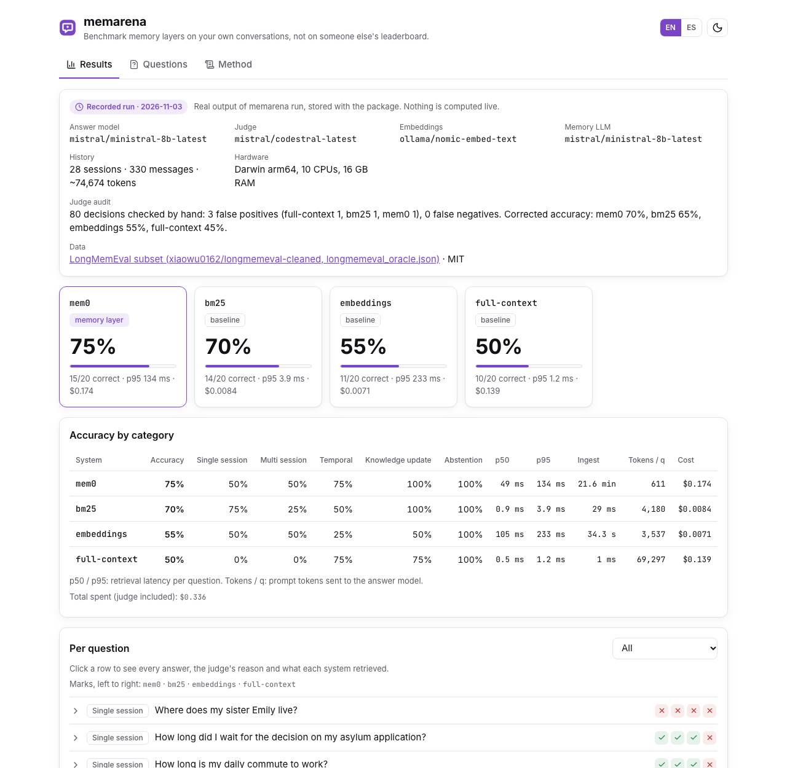
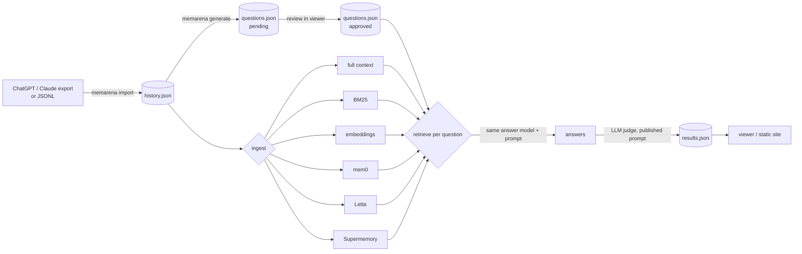

<p align="center">
  
</p>

<p align="center">
  <a href="https://github.com/diegoperezg7/memarena/actions/workflows/ci.yml"></a>
  <a href="LICENSE"></a>
  <a href="https://github.com/diegoperezg7/memarena/releases"></a>
  <a href="https://github.com/diegoperezg7/memarena/stargazers"></a>
</p>

<p align="center"><b>Benchmark memory layers on your own conversations, not on someone else's leaderboard.</b></p>

<p align="center">English · <a href="README.es.md">Español</a> · <a href="https://diegoperezg7.github.io/memarena/">Live example viewer</a></p>

memarena turns your ChatGPT or Claude export into a memory test: it writes questions with gold answers
from your own history (you review them), feeds the history to each memory layer, asks every question and
grades the answers with a published LLM-judge prompt. Every run also includes the two things a memory layer
has to beat: **pasting the whole history** and **simple retrieval** (BM25 and embeddings).



## Why

The public memory harnesses are each published by a memory vendor and are built around fixed datasets:
[supermemoryai/memorybench](https://github.com/supermemoryai/memorybench) (334 stars, Supermemory),
[vectorize-io/agent-memory-benchmark](https://github.com/vectorize-io/agent-memory-benchmark) (163, Vectorize) and
[mem0ai/memory-benchmarks](https://github.com/mem0ai/memory-benchmarks) (134, Mem0) (star counts checked 2026-11-03).

Vendor numbers do not agree with each other. Mem0's paper reports, on LoCoMo, a 26% relative improvement in
LLM-as-a-Judge over OpenAI's memory and 91% lower p95 latency with over 90% fewer tokens than full context
([arXiv 2504.19413](https://arxiv.org/abs/2504.19413)). Letta then reported 74.0% on LoCoMo with GPT-4o mini for a
plain filesystem agent, against the 68.5% Mem0 published for itself, adding that
"Mem0 did not respond to requests for clarification"
([Letta blog, 12 Aug 2025](https://www.letta.com/blog/benchmarking-ai-agent-memory)). Zep reports 94.8% on DMR vs
93.4% for MemGPT and up to 18.5% higher accuracy on LongMemEval ([arXiv 2501.13956](https://arxiv.org/abs/2501.13956)).

Whichever is right on LoCoMo, none of it tells you how a memory layer does on **your** conversations, with
**your** model, against the cheap option of pasting everything. memarena is vendor-neutral, runs on your
exports, and always puts full context, BM25 and embeddings in the same table.

## Quickstart

Recorded demo, no keys, no Docker, no model calls (under 2 minutes from a clean machine with `uv`):

```bash
uvx --from git+https://github.com/diegoperezg7/memarena@v0.1.1 memarena demo
```

or from a clone:

```bash
git clone https://github.com/diegoperezg7/memarena && cd memarena && uv run memarena demo
```


It prints the table below and opens the viewer on http://127.0.0.1:8765 (add `--no-view` to only print).
`uvx memarena` is coming to PyPI.

## Example output

This is a **recorded real run** (`memarena run`, 2026-11-03), shipped in the package and shown by `memarena demo`:
20 questions (4 per category) from [LongMemEval](https://huggingface.co/datasets/xiaowu0162/longmemeval-cleaned)
(MIT), with the evidence sessions of all 20 merged into **one** history of 28 sessions (~75k tokens), the way a
single user's export looks.

| System | Accuracy | Single | Multi | Temporal | Update | Abstain | Retrieval p50 / p95 | Ingest | Prompt tokens / q | Cost |
|---|---:|---:|---:|---:|---:|---:|---:|---:|---:|---:|
| **mem0** (memory layer) | **75%** | 50% | 50% | 75% | 100% | 100% | 49 / 134 ms | 21.6 min | 611 | $0.174 |
| bm25 (baseline) | 70% | 75% | 25% | 50% | 100% | 100% | 0.9 / 3.9 ms | 0.03 s | 4,180 | $0.008 |
| embeddings (baseline) | 55% | 50% | 50% | 25% | 50% | 100% | 105 / 233 ms | 34 s | 3,537 | $0.007 |
| full-context (baseline) | 50% | 0% | 0% | 75% | 75% | 100% | 0.5 / 1.2 ms | 0 s | 69,297 | $0.139 |

Setup: answer model `mistral/ministral-8b-latest` (same for every system), judge `mistral/codestral-latest`,
mem0 2.2.1 with `ministral-8b-latest` for fact extraction, embeddings `nomic-embed-text` on local Ollama, top 10
items per retriever. Hardware: Apple silicon laptop, 10 CPUs, 16 GB RAM; the local Ollama server was shared with
other jobs during the run, so the embedding latencies are pessimistic. 20 questions is a small sample: treat
differences of one or two questions as noise.

What this small run shows:

- **Pasting everything lost.** With ~69k prompt tokens per question, the 8B answer model said "I don't know" to
  every single-session and multi-session question, while answering the same questions from retrieved snippets.
- **mem0 sent about 1% of the full-context prompt** (611 vs 69,297 tokens per question) and scored highest, but
  its ingestion took 21.6 minutes and $0.17 of LLM calls for 165 turns (one extraction call per turn), against
  0.03 s for BM25.
- **BM25 was 5 points behind mem0** at almost no cost. That gap is one question.
- **Judge audit.** I checked all 80 judge decisions by hand: 3 false positives, all temporal (one each for
  full-context, bm25 and mem0, e.g. "about 1 week ago" accepted for "4 weeks"), and no false negatives. Corrected
  accuracy: mem0 70%, bm25 65%, embeddings 55%, full-context 45%. The order does not change. The table shows the
  judge's raw output, as the tool produced it.
- Total spent on this run: **$0.34** (Mistral API, priced from the token counts it returned).

Browse every answer, the judge's reasoning and what each system retrieved in the
[example viewer](https://diegoperezg7.github.io/memarena/).

## Use it on your own history

```bash
# 1. Import your export (ChatGPT or Claude conversations.json, the export .zip, or JSONL)
uvx --from git+https://github.com/diegoperezg7/memarena@v0.1.1 memarena import conversations.json --out history.json

# 2. Generate questions with gold answers and evidence pointers (written as "pending")
memarena generate history.json --out questions.json            # local Ollama by default

# 3. Review them: edit, approve or reject in the viewer (saved back to questions.json)
memarena view --questions questions.json --history history.json

# 4. Run the benchmark on the approved questions
memarena run history.json questions.json --systems full-context,bm25,embeddings,mem0

# 5. Look at the results, or export a static site
memarena view results.json
memarena export results.json --questions questions.json --out site
```

mem0, Letta and Supermemory are optional extras: run with
`uvx --from 'memarena[mem0] @ git+https://github.com/diegoperezg7/memarena@v0.1.1' memarena run ...`
(or `uv sync --extra mem0` in a clone).

**Privacy.** With `--provider ollama` and local systems nothing leaves your machine. With a cloud provider,
Supermemory or Letta Cloud, memarena lists where your conversations will go and asks before sending
(`--yes` skips the question). Generated questions must be reviewed: an unreviewed question set makes the
benchmark unreliable, so `run` only uses approved questions unless you pass `--include-pending`.

## How it works



- **Same answer model for everyone.** A system only decides what context reaches the answer model, so accuracy
  differences come from memory, not prompting.
- **Questions** follow LongMemEval's categories: single-session, multi-session, temporal, knowledge update and
  abstention (the answer is not in the history and the right reply is "I don't know").
- **Metrics**: accuracy from the LLM judge ([exact prompt](docs/judge-prompt.md)), retrieval latency p50/p95,
  ingestion time, prompt tokens per question and cost, overall and per category.
- **Budget**: `--max-cost` (default 1 USD) is checked before every paid call; when it would be exceeded the run
  stops and keeps partial results. Local models count as 0.

## Systems

| System | Kind | Runs | Status in v0.1 |
|---|---|---|---|
| `full-context` | baseline | anywhere | whole history pasted, newest kept if over `--max-context-tokens` |
| `bm25` | baseline | local, no deps | Okapi BM25 over user/assistant turn pairs |
| `embeddings` | baseline | Ollama or any OpenAI-compatible embeddings | cosine search over turn pairs |
| `mem0` | memory | local (mem0ai 2.2.1 OSS, Qdrant on disk) | live-tested (recorded demo); also smoke-tested with Ollama |
| `letta` | memory | Letta REST API (letta-client 1.12.1) | **not live-tested**: mock-tested only, see below |
| `supermemory` | memory | Supermemory API (supermemory 5.0.1), needs `SUPERMEMORY_API_KEY` | **not live-tested**: no key was available, mock-tested only |

Notes found while building the adapters:

- **mem0 and OpenRouter.** mem0 2.2.1's OpenAI-compatible client switches to OpenRouter whenever
  `OPENROUTER_API_KEY` is set in the environment, ignoring the configured base URL. memarena hides that variable
  from mem0 unless you chose OpenRouter, so your history goes only where you said. mem0's telemetry is turned off.
- **mem0 defaults.** memarena tests mem0's default install. Its BM25 keyword search and spaCy lemmatization need
  the `mem0ai[nlp,extras]` extras, which v0.1 does not install, so mem0 runs with semantic search only.
- **Letta.** Since 0.34 the `letta/letta` Docker image and the `letta` PyPI package ship "Letta Code"; the old
  self-hosted Python REST server is end-of-life (the image says so when you start it the old way). The adapter
  uses the REST API through `letta-client`, so it needs Letta Cloud (`LETTA_API_KEY`) or a self-hosted server
  that still exposes `/v1`. It writes each turn to the agent's archival memory and searches it; it does not drive
  the agent loop.

## Configuration

| Option | Default | What it does |
|---|---|---|
| `--provider`, `--model` | `ollama`, `qwen3:4b` | answer model (also used by `generate`) |
| `--judge-provider`, `--judge-model` | same as answer model | judge |
| `--embed-provider`, `--embed-model` | `ollama`, `nomic-embed-text` | embeddings baseline and mem0's embedder |
| `--memory-provider`, `--memory-model` | `ollama`, `qwen3:4b` | LLM inside mem0 / Letta |
| `--systems` | `full-context,bm25,embeddings,mem0` | what to compare |
| `--top-k` | 10 | items each retriever returns |
| `--max-context-tokens` | 100000 | cap for the full-context baseline |
| `--max-cost` | 1.0 | USD budget, checked before every paid call |
| `--price in,out` | built-in table | override the USD-per-million-token price of the answer model |

Providers (one OpenAI-compatible client, keys only from environment variables, see [.env.example](.env.example)):
`ollama` (`OLLAMA_HOST`, default http://localhost:11434), `openai` (`OPENAI_API_KEY`), `openrouter`
(`OPENROUTER_API_KEY`), `mistral` (`MISTRAL_API_KEY`). Optional systems: `SUPERMEMORY_API_KEY`, `LETTA_API_KEY`,
`LETTA_BASE_URL`. memarena sends no telemetry.

**Ollama context window.** Ollama serves models with a small default window (4096 tokens for `qwen3:4b` here) and
its OpenAI-compatible `/v1` endpoint cannot change it per request, so long prompts are cut silently. Create a
variant with a bigger window once (it shares the weights, no extra disk) and point memarena at it:

```bash
printf 'FROM qwen3:4b\nPARAMETER num_ctx 16384\n' > Modelfile && ollama create qwen3:4b-16k -f Modelfile
memarena run history.json questions.json --model qwen3:4b-16k --memory-model qwen3:4b-16k \
  --max-context-tokens 12000 --num-ctx 16384
```

Keep `--max-context-tokens` below the window (leave room for the question and the answer) so the full-context
baseline truncates visibly in the results instead of silently on the server, and keep `--num-ctx` equal to the
variant's window so mem0's calls do not force Ollama to reload the model. Local reasoning models such as qwen3
think before answering, which is slow on a laptop. The recorded demo did not use Ollama for chat: its answer model
(`ministral-8b-latest`, 128k window) received at most ~69.3k prompt tokens per question, so nothing was cut.

Reproduce the demo data and run:

```bash
curl -LO https://huggingface.co/datasets/xiaowu0162/longmemeval-cleaned/resolve/main/longmemeval_oracle.json
memarena longmemeval longmemeval_oracle.json --out-dir lme --per-category 4 --max-chars 16000
memarena run lme/history.json lme/questions.json --systems full-context,bm25,embeddings,mem0 \
  --provider mistral --model ministral-8b-latest --judge-model codestral-latest \
  --memory-provider mistral --memory-model ministral-8b-latest --yes --max-cost 2
```

## Roadmap

- More memory systems: Zep / Graphiti (need Neo4j or FalkorDB), cognee, MemOS.
- claude-mem is out of scope for now: it is a Claude Code session plugin, not an API to ingest conversations.
- Letta agent-loop mode (let the agent edit its own memory while reading the history).
- mem0 with its `nlp` and `extras` (hybrid search) as a separate configuration.
- Repeated runs with confidence intervals.
- LoCoMo is not bundled: its license (CC BY-NC 4.0) is not compatible with an MIT package.

## License

[MIT](LICENSE). The demo data is a subset of LongMemEval
([xiaowu0162/longmemeval-cleaned](https://huggingface.co/datasets/xiaowu0162/longmemeval-cleaned)), MIT licensed;
see its paper for attribution.
